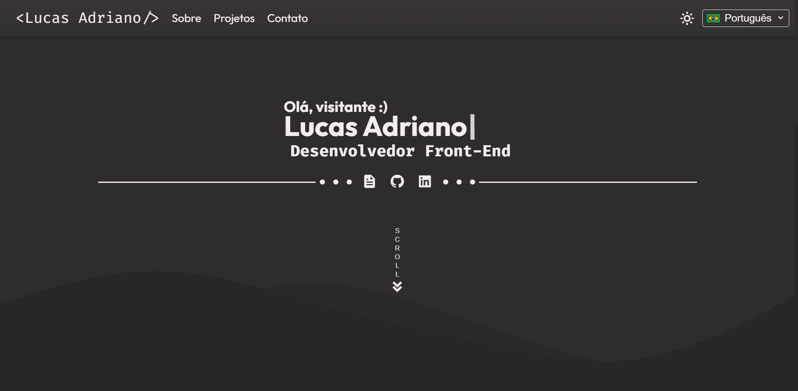

# Portfólio de Lucas Adriano

Portfólio pessoal desenvolvido com **Next.js** e **TypeScript**, com estilização em **SASS** organizada em arquitetura modular, suporte a modo claro/escuro e versões em português, inglês e espanhol via rotas dinâmicas.



## Índice

- [Tecnologias Utilizadas](#tecnologias-utilizadas)
- [Funcionalidades](#funcionalidades)
- [Estrutura do Projeto](#estrutura-do-projeto)
- [Como Executar o Projeto](#como-executar-o-projeto)
- [Licença](#licença)
- [Contato](#contato)

## Tecnologias Utilizadas

- **Next.js 16** (App Router) — estrutura das páginas e rotas
- **React 19** + **TypeScript**
- **SASS** — estilização em arquitetura modular (base, components, layout, themes, sections, animations, utils)
- **Radix UI** — componente de diálogo acessível (modal de projetos)

## Funcionalidades

- **Modo claro e escuro**, com preferência salva em cookie
- **Suporte multilíngue** — português, inglês e espanhol, com seletor de idioma
- **Vitrine de projetos** com carrossel de imagens e modal de detalhes por projeto
- **Efeitos de interface** — cursor com glow, efeito de digitação (typewriter) e botão de voltar ao topo
- **Currículo para download** em PDF
- **Design responsivo**, de mobile a desktop

## Estrutura do Projeto

```
src/
├── app/
│   ├── [lang]/         # Páginas por idioma (rotas dinâmicas)
│   └── layout.tsx      # Layout raiz, fontes e metadata
├── components/
│   ├── sections/        # Hero, Perfil, Projetos, Contato
│   ├── ui/               # Cards, carrossel, tooltip, navegação, etc.
│   ├── modals/           # Modal de detalhes do projeto
│   └── layout/           # Componentes estruturais de layout
├── data/                # Conteúdo de projetos, skills e contatos
├── lib/i18n/translations # Traduções (pt-br, en, es)
└── styles/               # SASS modular (base, components, layout, themes, sections, animations, utils)
```

## Como Executar o Projeto

1. Clone este repositório:

    ```bash
    git clone https://github.com/lucasatdriano/portfolio-next.git
    cd portfolio-next
    ```

2. Instale as dependências:

    ```bash
    npm install
    ```

3. Execute o projeto:

    ```bash
    npm run dev
    ```

4. Acesse [http://localhost:3000](http://localhost:3000) no navegador.

## Licença

Distribuído sob a licença Apache 2.0. Veja [`LICENSE`](LICENSE) para mais detalhes.

## Contato

Desenvolvido por Lucas Adriano.

- **E-mail**: [lucasatdriano@gmail.com](mailto:lucasatdriano@gmail.com)
- **LinkedIn**: [Lucas Adriano](https://linkedin.com/in/lucasadrianodev)
